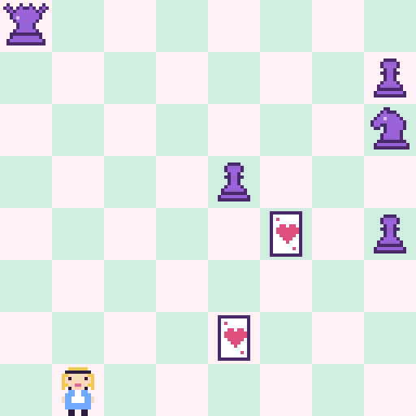

# Damas Locas

Alicia cruza un tablero de ajedrez donde las piezas amenazan como locas: las torres, los alfiles y las damas, a través de
todo. Empuja piezas y naipes, deja que se ataquen entre ellas y llega viva a la última fila. Niveles propios, cada uno con
su mínimo demostrado con las reglas del propio juego. Juego web autónomo en **PuzzleScript Next**.

## Cómo se juega
- **Objetivo:** llevar a Alicia viva hasta la última fila.
- **Flechas:** moverse; si hay una pieza delante y detrás tiene sitio, la empujas (solo una). **Z:** deshacer · **R:** reiniciar.
- **Amenazas:** tras cada paso, cada pieza amenaza como en el ajedrez (peón: sus dos diagonales de arriba; rey: las 8 de alrededor; caballo: las 8 en L).
- **Piezas locas:** torres, alfiles y damas amenazan su línea entera hasta el borde, atravesando todo.
- **Caen todos:** lo amenazado cae, piezas y Alicia.
- **Naipe** (novedad de esta versión): corta las líneas de torres, alfiles y damas, no cae nunca y se puede empujar.
- **Ayudas** (arriba a la derecha): ver las casillas amenazadas, reiniciar, pista, deshacer y solución animada.

## Niveles
1. Peones de guardia: mínimo 8 pasos
2. Salto de caballo: mínimo 8 pasos
3. La torre loca: mínimo 19 pasos
4. Corte de baraja: mínimo 15 pasos
5. Carta y caballo: mínimo 21 pasos
6. Alfil sin freno: mínimo 25 pasos
7. La Reina de Corazones: mínimo 26 pasos
8. La Reina Roja y la Blanca: mínimo 34 pasos
9. Corre que te corre: mínimo 37 pasos
10. Merienda de locos: mínimo 38 pasos
11. Dos reyes: mínimo 49 pasos
12. Partida de croquet: mínimo 56 pasos
13. Al otro lado del espejo: mínimo 67 pasos

## Créditos
- Niveles, naipe, arte 16-bit y tarjetas: **Spider** (Fali + Claude), 2026
- Juego original: *Mad Queens*, de **Chris Pickel** (galería de PuzzleScript)
- Motor: [PuzzleScript Next](https://github.com/david-pfx/PuzzleScriptNext), incrustado en un único `index.html`
- Fuente del juego: [`juego.txt`](juego.txt)
